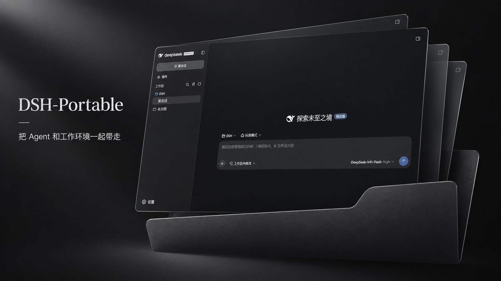

# DSH-Portable

<a href="README.md">English</a> · <a href="README.zh-CN.md">简体中文</a> · <a href="README.ja.md">日本語</a> · <a href="README.es.md">Español</a> · <a href="README.fr.md">Français</a> · <strong>Deutsch</strong> · <a href="README.ru.md">Русский</a> · <a href="README.pt-BR.md">Português (Brasil)</a>

  

## Offizielle Desktop-App oder portable Version?

- **Für die meisten Nutzer** empfehlen wir die [offizielle DeepSeek Harness Desktop-App](https://www.deepseek.com/harness/).
- **Für die portable Nutzung** hält [DSH-Portable](https://github.com/WSL043/DSH-Portable/releases/latest) App und Daten in einem Ordner.

Manuelle Wartung und Veröffentlichungen können künftig seltener erfolgen. Die Wartung konzentriert sich auf den portablen Betrieb, Kompatibilität und wichtige Fehlerbehebungen.

DeepSeek Harness zum Mitnehmen: Gespräche, Einstellungen, Plugins und Arbeitsbereich bleiben in einem Ordner. Für Windows, macOS und Linux.

## Erste Schritte

[Download](https://github.com/WSL043/DSH-Portable/releases/latest)

Laden Sie das Paket für Ihr System aus der neuesten Veröffentlichung herunter, entpacken Sie es vollständig und starten Sie die Desktop-App. Verschieben Sie immer den gesamten Ordner.

## Sprache

Menüs, Infobereich, Updates und Wartung folgen der Spracheinstellung von DSH. Die verfügbaren Sprachen hängen von der Kernversion ab. Englisch dient als Ausweichsprache.

## Updates und Wiederherstellung

In 0.x lassen sich Portable und der Kern unter **Einstellungen → Updates** getrennt aktualisieren. Kopieren Sie für ein Offline-Update unter Windows den erhaltenen Ordner und wählen Sie seine JSON-Datei. [Anleitung auf Englisch](README.md#update-an-existing-installation)

## Umfang

Portable verwaltet Desktop, Laufzeitumgebung, Updates, Migration und Wiederherstellung. Gespräche und Modelle verwaltet das offizielle DSH.

## Anleitungen und Hilfe

- [English README](README.md)
- [User guide / English](docs/user-guide.en.md)
- [Offline updates](docs/offline-updates.md)
- [Report an issue](https://github.com/WSL043/DSH-Portable/issues/new?template=bug-report.yml)
