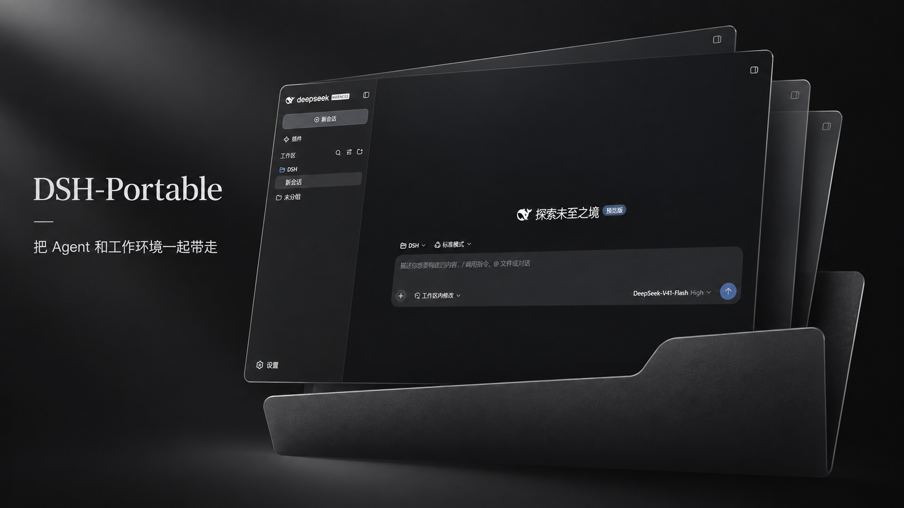

# DSH-Portable

<a href="README.md">English</a> · <a href="README.zh-CN.md">简体中文</a> · <a href="README.ja.md">日本語</a> · <a href="README.es.md">Español</a> · <a href="README.fr.md">Français</a> · <strong>Deutsch</strong> · <a href="README.ru.md">Русский</a> · <a href="README.pt-BR.md">Português (Brasil)</a>

  

DeepSeek Harness zum Mitnehmen: Gespräche, Einstellungen, Plugins und Arbeitsbereich bleiben in einem Ordner. Für Windows, macOS und Linux.

## Erste Schritte

[Download](https://github.com/WSL043/DSH-Portable/releases/latest)

Laden Sie das Paket für Ihr System aus der neuesten Veröffentlichung herunter, entpacken Sie es vollständig und starten Sie die Desktop-App. Verschieben Sie immer den gesamten Ordner.

## Sprache

Im noch unveröffentlichten main folgen Menüs, Infobereich, Updates und Wartung der Spracheinstellung von DSH. Zusätzliche Sprachen benötigen einen passenden offiziellen Kern wie DSH 0.2.2-rc.1. Englisch ist die Ausweichsprache. Plugins liefern ihre eigenen Übersetzungen. Bereits veröffentlichte Pakete bleiben unverändert.

## Updates und Wiederherstellung

Der Kern kann getrennt aktualisiert werden. Ein vollständiges Portable-Update kann zum mitgelieferten Kern wechseln. Offline-Updates, Sicherung, Reparatur und Rückkehr zu früheren Versionen beschreibt die englische Anleitung.

## Umfang

Portable verwaltet Desktop, Laufzeitumgebung, Updates, Migration und Wiederherstellung. Gespräche und Modelle verwaltet das offizielle DSH.

## Anleitungen und Hilfe

- [English README](README.md)
- [User guide / English](docs/user-guide.en.md)
- [Offline updates](docs/offline-updates.md)
- [Report an issue](https://github.com/WSL043/DSH-Portable/issues/new?template=bug-report.yml)
