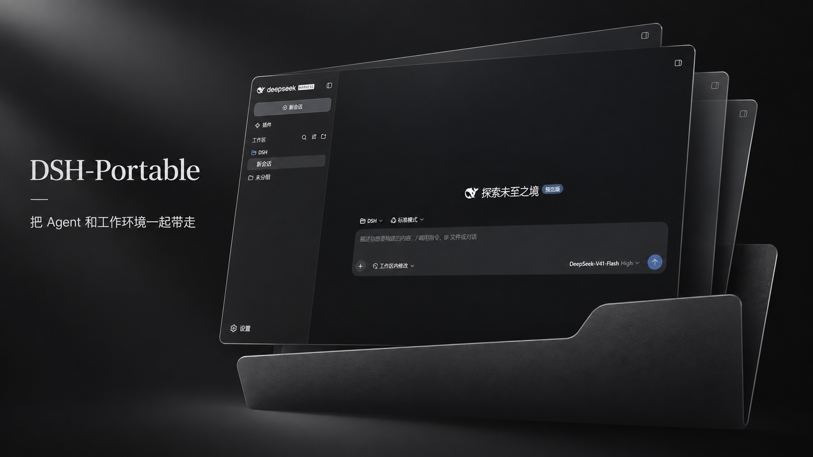

# DSH-Portable

<a href="README.md">English</a> · <a href="README.zh-CN.md">简体中文</a> · <a href="README.ja.md">日本語</a> · <a href="README.es.md">Español</a> · <strong>Français</strong> · <a href="README.de.md">Deutsch</a> · <a href="README.ru.md">Русский</a> · <a href="README.pt-BR.md">Português (Brasil)</a>

  

## Application officielle ou édition portable ?

- **Dans la plupart des cas**, nous recommandons [l’application de bureau officielle DeepSeek Harness](https://www.deepseek.com/harness/).
- **Pour un usage portable**, [DSH-Portable](https://github.com/WSL043/DSH-Portable/releases/latest) réunit l’application et ses données dans un seul dossier.

Les interventions manuelles et les publications pourraient devenir moins fréquentes. La maintenance se concentrera sur la portabilité, la compatibilité et les correctifs importants.

DeepSeek Harness portable : conversations, réglages, extensions et espace de travail restent dans un dossier. Disponible pour Windows, macOS et Linux.

## Démarrer

[Download](https://github.com/WSL043/DSH-Portable/releases/latest)

Téléchargez le paquet de votre système depuis la dernière version, extrayez-le entièrement et lancez l’application. Conservez le dossier complet lors des déplacements.

## Langue

Dans main, non encore publié, les menus, la zone de notification, les mises à jour et la maintenance suivent la langue de DSH officiel. Les langues supplémentaires nécessitent un noyau compatible, tel que DSH 0.2.2-rc.1. La langue de secours est l’anglais. Chaque extension fournit ses traductions. Les paquets déjà publiés restent inchangés.

## Mise à jour et récupération

Le noyau peut être mis à jour séparément. Une mise à jour complète de Portable peut basculer vers le noyau fourni. Consultez le guide anglais pour les mises à jour hors ligne, sauvegardes, réparations et retours en arrière.

## Périmètre

Portable gère le bureau, l’environnement, les mises à jour, la migration et la récupération. DSH officiel gère les conversations et les modèles.

## Guides et assistance

- [English README](README.md)
- [User guide / English](docs/user-guide.en.md)
- [Offline updates](docs/offline-updates.md)
- [Report an issue](https://github.com/WSL043/DSH-Portable/issues/new?template=bug-report.yml)
