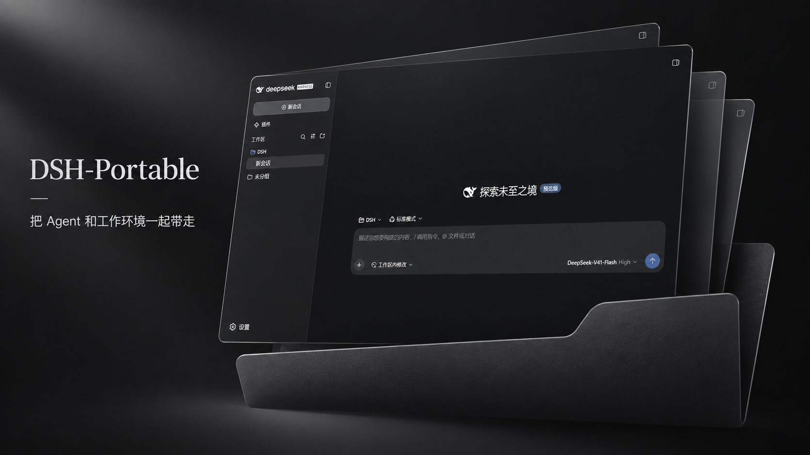

# DSH-Portable

<a href="README.md">English</a> · <a href="README.zh-CN.md">简体中文</a> · <strong>日本語</strong> · <a href="README.es.md">Español</a> · <a href="README.fr.md">Français</a> · <a href="README.de.md">Deutsch</a> · <a href="README.ru.md">Русский</a> · <a href="README.pt-BR.md">Português (Brasil)</a>

  

## 公式デスクトップ版とポータブル版

- **通常の利用**には、[DeepSeek Harness 公式デスクトップ版](https://www.deepseek.com/harness/)をおすすめします。
- **持ち運びたい場合**は、[DSH-Portable](https://github.com/WSL043/DSH-Portable/releases/latest)でアプリとデータを同じフォルダーにまとめられます。

今後は手動での保守やリリースの頻度が下がる可能性があります。保守はポータブル運用、互換性、重要な修正を中心に続けます。

DeepSeek Harness をフォルダーごと持ち運べます。会話・設定・プラグイン・ワークスペースをまとめて保管し、Windows / macOS / Linux で使用できます。

## 使い始める

[Download](https://github.com/WSL043/DSH-Portable/releases/latest)

最新版の配布ページから使用する OS のパッケージを取得し、全体を展開してデスクトップアプリを起動してください。移動するときはフォルダー全体を保管してください。

## 言語

メニュー・トレイ・更新・保守画面は公式 DSH の言語設定に追従します。言語の選択肢はコアのバージョンによって異なります。未対応の言語は英語で表示されます。

## 更新と復旧

0.x は **設定 → 更新** で Portable とコアを個別に更新できます。Windows のオフライン更新では、取得したフォルダーをそのまま移し、**ファイルから更新** で中の JSON を選びます。[更新手順（英語）](README.md#update-an-existing-installation)

## 保守範囲

Portable はデスクトップ画面・実行環境・更新・移行・復旧を担当します。会話やモデルなどの機能は公式 DSH が管理します。

## 詳しいガイドとサポート

- [English README](README.md)
- [User guide / English](docs/user-guide.en.md)
- [Offline updates](docs/offline-updates.md)
- [Report an issue](https://github.com/WSL043/DSH-Portable/issues/new?template=bug-report.yml)
