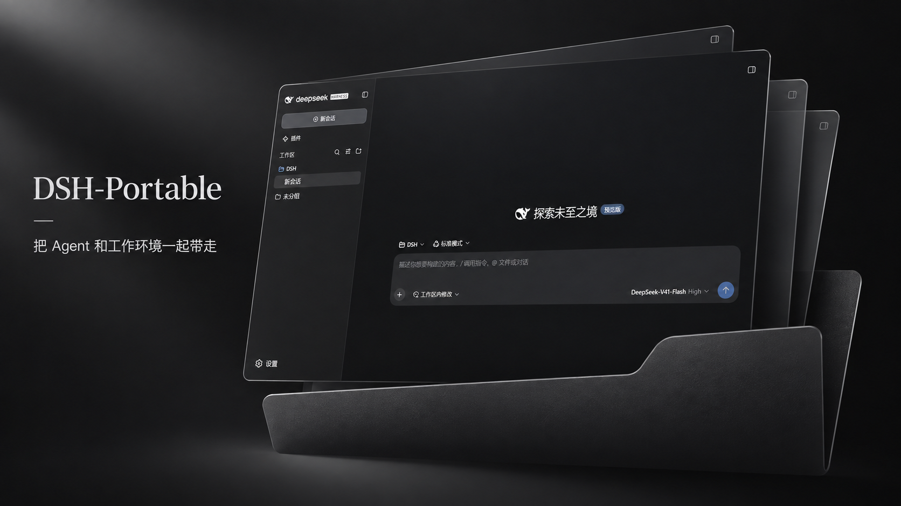

<p align="center">
  
</p>

<h1 align="center">DSH-Portable</h1>

<p align="center"><strong>English</strong> · <a href="README.zh-CN.md">简体中文</a> · <a href="README.ja.md">日本語</a> · <a href="README.es.md">Español</a> · <a href="README.fr.md">Français</a> · <a href="README.de.md">Deutsch</a> · <a href="README.ru.md">Русский</a> · <a href="README.pt-BR.md">Português (Brasil)</a></p>

<p align="center">
  <strong>Portable DeepSeek Harness: copy one folder to a USB drive and keep working on another computer.</strong><br>
  Stable 0.x runs on Windows, macOS, and Linux. The 1.x release candidate runs the official Desktop on Windows x64.
</p>

<p align="center">
  <a href="https://wsl043.github.io/DSH-Portable/"><strong>Website</strong></a>
  · <a href="#downloads"><strong>Downloads</strong></a>
  · <a href="#start-in-3-steps">Get started</a>
  · <a href="docs/user-guide.en.md">User guide</a>
  · <a href="#plugins">Plugins</a>
  · <a href="#get-help">Support</a>
</p>

<p align="center">
  <a href="https://github.com/WSL043/DSH-Portable"></a>
  <a href="https://github.com/WSL043/DSH-Portable/releases/latest"></a>
  <a href="https://github.com/WSL043/DSH-Portable/releases"></a>
  <a href="https://github.com/WSL043/DSH-Portable/actions/workflows/ci.yml"></a>
  <a href="LICENSE"></a>
</p>

<p align="center">
  <a href="https://github.com/WSL043/DSH-Portable/releases/latest/download/DSH-Portable-windows-x64.exe"><strong>Download 0.x for Windows</strong></a>
  · <a href="#1x-for-windows-x64">Try 1.x on Windows x64</a>
</p>

<p align="center">
  
</p>

> DSH-Portable is an independent community distribution, not an official DeepSeek application and not endorsed by DeepSeek.<br>
> DeepSeek also offers an [official desktop app](https://www.deepseek.com/harness/); each option serves different needs.

## Which should I choose?

| Edition | Platforms | Updates and recovery |
| --- | --- | --- |
| **0.x stable** for everyday use | Windows x64, macOS, Linux | Update Portable and the DSH core separately in **Settings → Updates**. |
| **1.x release candidate** for the official Desktop in a portable folder | Windows x64 | Use the Desktop’s **Install and Restart** prompt. Hold **Shift** when launching Portable for offline update, repair, and rollback. |

## Downloads

The Windows, macOS, and Linux downloads below are for **0.x stable**. The [1.x release candidate](#1x-for-windows-x64) has its own Windows ZIPs.

### Windows

| Choose this when… | Download |
| --- | --- |
| You have internet access and want the folder prepared automatically | [Online portable launcher](https://github.com/WSL043/DSH-Portable/releases/latest/download/DSH-Portable-windows-x64.exe) (recommended) |
| You prefer to download and extract it yourself | [Standard ZIP](https://github.com/WSL043/DSH-Portable/releases/latest/download/DSH-Portable-windows-x64-offline.zip) |
| WebView2 is missing and the target cannot download it | [Complete offline ZIP](https://github.com/WSL043/DSH-Portable/releases/latest/download/DSH-Portable-windows-x64-complete-offline.zip) |

Not sure? Use the online launcher with internet, or the standard ZIP for manual extraction. Windows 11 includes WebView2, and most Windows 10 PCs already have it; the complete offline ZIP includes it. See the [offline deployment requirements](docs/user-guide.en.md#offline-deployment).

### macOS

[Apple Silicon (arm64)](https://github.com/WSL043/DSH-Portable/releases/latest/download/DSH-Portable-macos-arm64.zip) · [Intel (x64)](https://github.com/WSL043/DSH-Portable/releases/latest/download/DSH-Portable-macos-x64.zip) · [First launch](docs/user-guide.en.md#macos)

### Linux

| Architecture | AppImage | Complete portable folder |
| --- | --- | --- |
| Intel / AMD (x64) | [Download](https://github.com/WSL043/DSH-Portable/releases/latest/download/DeepSeek-Herness-linux-x64.AppImage) | [Download](https://github.com/WSL043/DSH-Portable/releases/latest/download/DSH-Portable-linux-x64.tar.gz) |
| ARM64 | [Download](https://github.com/WSL043/DSH-Portable/releases/latest/download/DeepSeek-Herness-linux-arm64.AppImage) | [Download](https://github.com/WSL043/DSH-Portable/releases/latest/download/DSH-Portable-linux-arm64.tar.gz) |

See the [Linux guide](docs/user-guide.en.md#linux) for AppImage launch details, data location, and the complete folder.

For an existing 0.x folder, see the [offline update guide](docs/offline-updates.md#download-files-english).

### 1.x for Windows x64

| Package | When to use it |
| --- | --- |
| [Full ZIP](https://github.com/WSL043/DSH-Portable/releases/download/v1.0.0-rc.1/DSH-Portable-1.0.0-rc.1-windows-x64.zip) | Includes the official Desktop and can start offline. |
| [Lite ZIP](https://github.com/WSL043/DSH-Portable/releases/download/v1.0.0-rc.1/DSH-Portable-1.0.0-rc.1-windows-x64-lite.zip) | Downloads and verifies the official Desktop on first launch. |

Extract [1.0.0-rc.1](https://github.com/WSL043/DSH-Portable/releases/tag/v1.0.0-rc.1) into a separate folder and run `DeepSeek Harness Portable.exe`. To bring supported 0.x data over, use the [migration guide](docs/pure-portable-operations.md#旧-native-数据迁入).

The 1.x workflow checks the official Windows Desktop feeds on an hourly schedule. It publishes each channel after signature, SHA-512, update, and recovery checks pass. Use the development channel for RC builds. The stable channel serves official final releases once they are available and verified. When the app offers an update, choose **Install and Restart**. Portable rolls back if the new version fails its startup check. See the [1.x update and recovery guide](docs/pure-portable-operations.md).

## Start in 3 steps

These steps use the **0.x Windows online launcher**.

1. Download the [Windows portable launcher](https://github.com/WSL043/DSH-Portable/releases/latest/download/DSH-Portable-windows-x64.exe).
2. Put it where you want the app to live and run it; it prepares the complete DSH-Portable folder beside it.
3. Connect a model service; next time, run DeepSeek-Herness.exe from that folder.

On macOS and Linux, extract and run; see the [guide](docs/user-guide.en.md#macos) for first-launch notes.

The close button sends the app to the tray, so tasks continue. To quit, use **File → Exit DeepSeek Harness**; on Windows press Ctrl+Q. The tray menu is an alternate exit path.

## How portability works

- **0.x data** lives in the portable folder. See where sessions, settings, plugins, and the workspace are stored in the [data guide](docs/user-guide.en.md#portable-data).
- **Move and resume:** Fully exit, then copy the entire folder to a USB drive or a computer with the same OS and architecture; see [migration steps](docs/user-guide.en.md#move-and-back-up).
- **0.x updates** preserve your data and let you choose a core version separately. See [updates and repair](docs/user-guide.en.md#updates-and-repair).
- **0.x recovery** includes checks, targeted repair, support reports, and DSH-Recovery.exe. See the [recovery guide](docs/user-guide.en.md#dsh-recoveryexe).

## Plugins

New packages no longer install community plugins by default. Use **Plugins → Installed / Discover** to manage them.

### Community index

In **Plugins → Discover**, open the source selector and choose **Manage index sources**. Paste this URL and select **Add**.

```text
https://cdn.jsdelivr.net/gh/WSL043/DSH-Portable-Updates@market-index/awesome-index.json
```

See the [plugin guide](docs/user-guide.en.md#plugins) for installation and updates.

## Choose your core version

Core selection applies to 0.x stable.

<!-- core-support:start -->
**Optional cores (up to 5 verified versions)** · Settings → Updates · Since 0.6.5 stable (first available in 0.6.5-rc.1).

<details>
<summary>View available cores for Portable 0.9.12</summary>

| Platform | Available cores |
| --- | --- |
| Windows x64 | [0.2.2-rc.1](https://github.com/WSL043/DSH-Portable-Updates/releases/download/update-channel-core-stable/dsh-core-index-windows-x64.json), [0.2.2-alpha.3](https://github.com/WSL043/DSH-Portable-Updates/releases/download/update-channel-core-stable/dsh-core-index-windows-x64.json), [0.2.2-alpha.2](https://github.com/WSL043/DSH-Portable-Updates/releases/download/update-channel-core-stable/dsh-core-index-windows-x64.json), [0.2.1-rc.5](https://github.com/WSL043/DSH-Portable-Updates/releases/download/update-channel-core-stable/dsh-core-index-windows-x64.json), [0.2.1-rc.4](https://github.com/WSL043/DSH-Portable-Updates/releases/download/update-channel-core-stable/dsh-core-index-windows-x64.json) |
| macOS arm64 | [0.2.2-rc.1](https://github.com/WSL043/DSH-Portable-Updates/releases/download/update-channel-core-stable/dsh-core-index-macos-arm64.json), [0.2.2-alpha.3](https://github.com/WSL043/DSH-Portable-Updates/releases/download/update-channel-core-stable/dsh-core-index-macos-arm64.json), [0.2.2-alpha.2](https://github.com/WSL043/DSH-Portable-Updates/releases/download/update-channel-core-stable/dsh-core-index-macos-arm64.json), [0.2.1-rc.5](https://github.com/WSL043/DSH-Portable-Updates/releases/download/update-channel-core-stable/dsh-core-index-macos-arm64.json), [0.2.1-rc.4](https://github.com/WSL043/DSH-Portable-Updates/releases/download/update-channel-core-stable/dsh-core-index-macos-arm64.json) |
| macOS x64 | [0.2.2-rc.1](https://github.com/WSL043/DSH-Portable-Updates/releases/download/update-channel-core-stable/dsh-core-index-macos-x64.json), [0.2.2-alpha.3](https://github.com/WSL043/DSH-Portable-Updates/releases/download/update-channel-core-stable/dsh-core-index-macos-x64.json), [0.2.2-alpha.2](https://github.com/WSL043/DSH-Portable-Updates/releases/download/update-channel-core-stable/dsh-core-index-macos-x64.json), [0.2.1-rc.5](https://github.com/WSL043/DSH-Portable-Updates/releases/download/update-channel-core-stable/dsh-core-index-macos-x64.json), [0.2.1-rc.4](https://github.com/WSL043/DSH-Portable-Updates/releases/download/update-channel-core-stable/dsh-core-index-macos-x64.json) |
| Linux x64 | [0.2.2-rc.1](https://github.com/WSL043/DSH-Portable-Updates/releases/download/update-channel-core-stable/dsh-core-index-linux-x64.json), [0.2.2-alpha.3](https://github.com/WSL043/DSH-Portable-Updates/releases/download/update-channel-core-stable/dsh-core-index-linux-x64.json), [0.2.2-alpha.2](https://github.com/WSL043/DSH-Portable-Updates/releases/download/update-channel-core-stable/dsh-core-index-linux-x64.json), [0.2.1-rc.5](https://github.com/WSL043/DSH-Portable-Updates/releases/download/update-channel-core-stable/dsh-core-index-linux-x64.json), [0.2.1-rc.4](https://github.com/WSL043/DSH-Portable-Updates/releases/download/update-channel-core-stable/dsh-core-index-linux-x64.json) |
| Linux arm64 | [0.2.2-rc.1](https://github.com/WSL043/DSH-Portable-Updates/releases/download/update-channel-core-stable/dsh-core-index-linux-arm64.json), [0.2.2-alpha.3](https://github.com/WSL043/DSH-Portable-Updates/releases/download/update-channel-core-stable/dsh-core-index-linux-arm64.json), [0.2.2-alpha.2](https://github.com/WSL043/DSH-Portable-Updates/releases/download/update-channel-core-stable/dsh-core-index-linux-arm64.json), [0.2.1-rc.5](https://github.com/WSL043/DSH-Portable-Updates/releases/download/update-channel-core-stable/dsh-core-index-linux-arm64.json), [0.2.1-rc.4](https://github.com/WSL043/DSH-Portable-Updates/releases/download/update-channel-core-stable/dsh-core-index-linux-arm64.json) |

The window covers the newest five versions, retaining at least two release candidates or finals. The table syncs compatible versions from the stable catalog and may contain fewer than five.

</details>

<!-- core-support:end -->

See the [updates and repair guide](docs/user-guide.en.md#updates-and-repair) for core selection, compatibility checks, and rollback.

## Roadmap

0.x focuses on stability. 1.x packages the official Desktop with Portable’s launcher, data handling, and recovery. See the [1.0 roadmap](docs/roadmap-toward-1.0.md) and [official Desktop packaging](experiments/official-payload/README.md).

## Get help

- [Report a bug](https://github.com/WSL043/DSH-Portable/issues/new?template=bug-report.yml) · [Request an improvement](https://github.com/WSL043/DSH-Portable/issues/new?template=feature-request.yml) · [Join a discussion](https://github.com/WSL043/DSH-Portable/discussions)
- See the [upstream note](https://github.com/deepseek-ai/deepseek-harness/discussions/5202) for network compatibility; do not paste API keys, login credentials, or private conversations into issues.

## Security

DSH can execute local code. Use trusted models, plugins, and projects. Read the [privacy notice](PRIVACY.md), [security policy](SECURITY.md), and [code-signing policy](CODE_SIGNING.md).

## Open source and contributing

This project uses [Apache-2.0](LICENSE) and includes its [component notice](NOTICE.md). Contributions are welcome; read [CONTRIBUTING.md](CONTRIBUTING.md) first.

<details>
<summary><strong>Build from source</strong></summary>

```powershell
./scripts/build-windows.ps1
```

```bash
bash scripts/build-macos.sh arm64   # or x64
bash scripts/build-linux.sh x64     # or arm64
```

Dependencies, release contents, and finished-product tests are pinned by the repository. Releases include checksums.txt; advanced users can verify a GitHub/Sigstore build attestation with gh attestation verify <download> -R WSL043/DSH-Portable.

</details>

If DSH-Portable helps, star the [GitHub repository](https://github.com/WSL043/DSH-Portable) and share it with people who want a portable workspace.

DeepSeek Harness, the DeepSeek name, and its marks belong to DeepSeek. DSH-Portable is independently maintained by WSL043 and is not endorsed by DeepSeek.

## Interface languages

In 0.x, Portable’s menus, tray, and maintenance UI follow the DSH language setting, with English as the fallback. Supported languages are English, Simplified Chinese, Japanese, Spanish, French, German, Russian, and Brazilian Portuguese. The official Desktop supplies the 1.x app interface.
