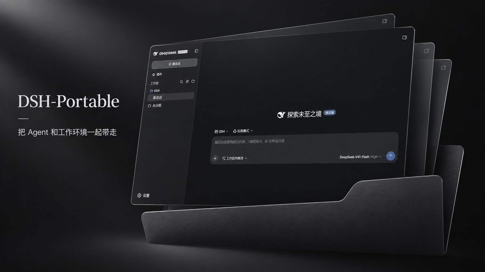

# DSH-Portable

<a href="README.md">English</a> · <a href="README.zh-CN.md">简体中文</a> · <a href="README.ja.md">日本語</a> · <a href="README.es.md">Español</a> · <a href="README.fr.md">Français</a> · <a href="README.de.md">Deutsch</a> · <a href="README.ru.md">Русский</a> · <strong>Português (Brasil)</strong>

  

## Aplicativo oficial ou versão portátil?

- **Para a maioria dos usuários**, recomendamos o [aplicativo oficial de desktop do DeepSeek Harness](https://www.deepseek.com/harness/).
- **Para uso portátil**, o [DSH-Portable](https://github.com/WSL043/DSH-Portable/releases/latest) mantém o aplicativo e os dados em uma só pasta.

A manutenção manual e os lançamentos podem se tornar menos frequentes. A manutenção terá foco na portabilidade, na compatibilidade e em correções importantes.

DeepSeek Harness portátil: conversas, configurações, plugins e área de trabalho ficam em uma pasta. Para Windows, macOS e Linux.

## Primeiros passos

[Download](https://github.com/WSL043/DSH-Portable/releases/latest)

Baixe o pacote do seu sistema na versão mais recente, extraia tudo e inicie o aplicativo. Preserve a pasta inteira ao mover para outro local.

## Idioma

Menus, bandeja, atualizações e manutenção seguem o idioma do DSH. Os idiomas disponíveis dependem da versão do núcleo. O inglês é o idioma de reserva.

## Atualização e recuperação

Na versão 0.x, atualize o Portable e o núcleo separadamente em **Configurações → Atualizações**. Para atualizar o Windows offline, copie a pasta obtida e selecione o arquivo JSON dentro dela. [Guia em inglês](README.md#update-an-existing-installation)

## Escopo

Portable cuida do desktop, ambiente, atualizações, migração e recuperação. Conversas e modelos são responsabilidade do DSH oficial.

## Guias e suporte

- [English README](README.md)
- [User guide / English](docs/user-guide.en.md)
- [Offline updates](docs/offline-updates.md)
- [Report an issue](https://github.com/WSL043/DSH-Portable/issues/new?template=bug-report.yml)
