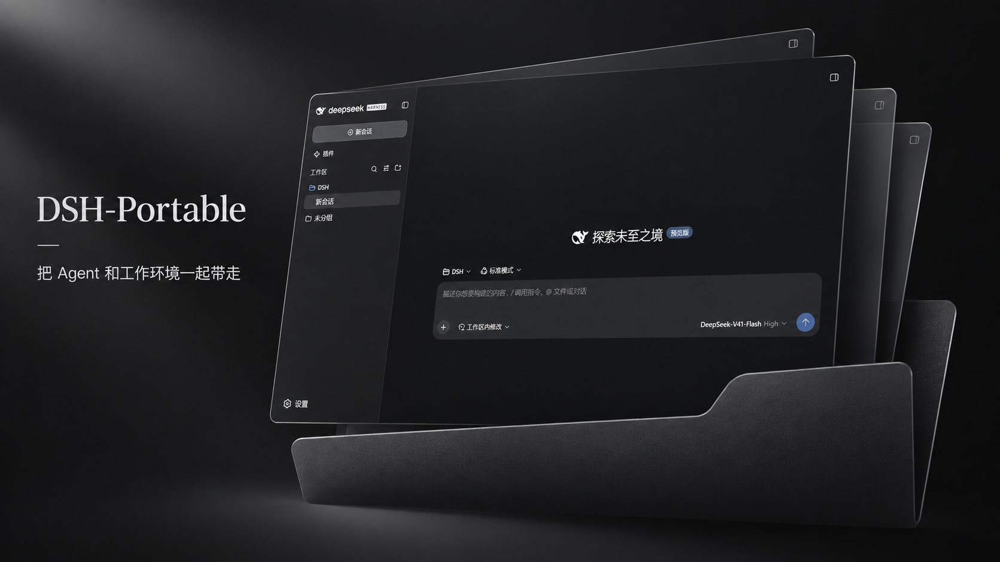

# DSH-Portable

<a href="README.md">English</a> · <a href="README.zh-CN.md">简体中文</a> · <a href="README.ja.md">日本語</a> · <a href="README.es.md">Español</a> · <a href="README.fr.md">Français</a> · <a href="README.de.md">Deutsch</a> · <strong>Русский</strong> · <a href="README.pt-BR.md">Português (Brasil)</a>

  

## Официальное приложение или переносная версия?

- **Для большинства пользователей** мы рекомендуем [официальное настольное приложение DeepSeek Harness](https://www.deepseek.com/harness/).
- **Для переносного использования** [DSH-Portable](https://github.com/WSL043/DSH-Portable/releases/latest) хранит приложение и данные в одной папке.

Ручное обслуживание и выпуск новых версий могут стать реже. Основное внимание будет уделяться переносимости, совместимости и важным исправлениям.

Переносимый DeepSeek Harness: диалоги, настройки, плагины и рабочая область хранятся в одной папке. Для Windows, macOS и Linux.

## Начало работы

[Download](https://github.com/WSL043/DSH-Portable/releases/latest)

Скачайте пакет для своей системы со страницы последнего выпуска, полностью распакуйте его и запустите приложение. При переносе сохраняйте всю папку.

## Язык

Меню, область уведомлений, обновления и обслуживание используют язык DSH. Набор языков зависит от версии ядра. Резервный язык — английский.

## Обновление и восстановление

В 0.x Portable и ядро обновляются отдельно в разделе **Настройки → Обновления**. Для автономного обновления в Windows скопируйте полученную папку и выберите в ней файл JSON. [Инструкция на английском](README.md#update-an-existing-installation)

## Границы проекта

Portable отвечает за рабочее окно, среду выполнения, обновления, перенос и восстановление. Диалоги и модели остаются задачей официального DSH.

## Руководства и помощь

- [English README](README.md)
- [User guide / English](docs/user-guide.en.md)
- [Offline updates](docs/offline-updates.md)
- [Report an issue](https://github.com/WSL043/DSH-Portable/issues/new?template=bug-report.yml)
