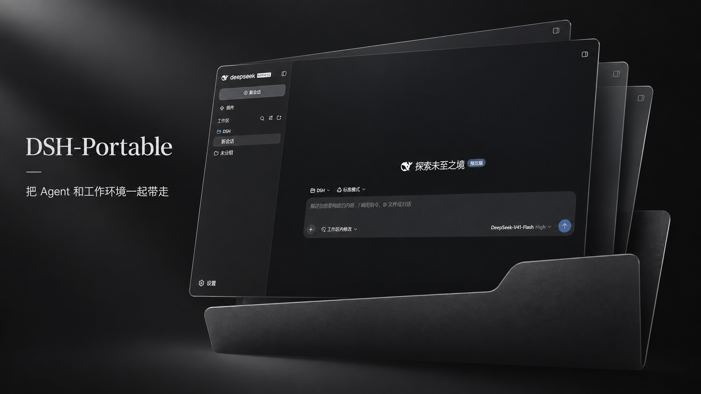

<p align="center">
  
</p>

<h1 align="center">DSH-Portable</h1>

<p align="center"><a href="README.md">English</a> · <strong>简体中文</strong> · <a href="README.ja.md">日本語</a> · <a href="README.es.md">Español</a> · <a href="README.fr.md">Français</a> · <a href="README.de.md">Deutsch</a> · <a href="README.ru.md">Русский</a> · <a href="README.pt-BR.md">Português (Brasil)</a></p>

<p align="center">
  <strong>DeepSeek Harness 便携版：整个文件夹拷到 U 盘，换一台电脑接着用。</strong><br>
  0.x 稳定版支持 Windows、macOS 和 Linux。1.x 候选版在 Windows x64 上运行官方桌面端。
</p>

<p align="center">
  <a href="https://wsl043.github.io/DSH-Portable/"><strong>官网</strong></a>
  · <a href="#下载"><strong>下载</strong></a>
  · <a href="#三步启动">开始使用</a>
  · <a href="docs/user-guide.zh-CN.md">用户指南</a>
  · <a href="#插件">插件</a>
  · <a href="#获取帮助">帮助</a>
</p>

<p align="center">
  <a href="https://github.com/WSL043/DSH-Portable"></a>
  <a href="https://github.com/WSL043/DSH-Portable/releases/latest"></a>
  <a href="https://github.com/WSL043/DSH-Portable/releases"></a>
  <a href="https://github.com/WSL043/DSH-Portable/actions/workflows/ci.yml"></a>
  <a href="LICENSE"></a>
</p>

<p align="center">
  <a href="https://github.com/WSL043/DSH-Portable/releases/latest/download/DSH-Portable-windows-x64.exe"><strong>下载 Windows 0.x 稳定版</strong></a>
  · <a href="#1x-候选版">试用 Windows x64 1.x</a>
</p>

<p align="center">
  
</p>

> DSH-Portable 是独立社区发行版，不是 DeepSeek 官方应用，未获 DeepSeek 背书。<br>
> DeepSeek 已提供[官方桌面端](https://www.deepseek.com/harness/)；两种选择各有侧重。

## 该选哪个

| 版本 | 适用平台 | 更新与恢复 |
| --- | --- | --- |
| **0.x 稳定版**，适合日常使用 | Windows x64、macOS、Linux | 在 **设置 → 更新** 分别更新 Portable 和 DSH 内核。 |
| **1.x 候选版**，在便携文件夹中运行官方桌面端 | Windows x64 | 在官方桌面端选择 **安装并重启**。按住 **Shift** 启动 Portable 可进入离线更新、修复和回退。 |

## 下载

下方 Windows、macOS 和 Linux 下载均为 **0.x 稳定版**。[1.x 候选版](#1x-候选版)有独立的 Windows x64 ZIP。

### Windows

| 需要 | 下载 |
| --- | --- |
| 联网自动准备文件夹 | [在线便携启动器](https://github.com/WSL043/DSH-Portable/releases/latest/download/DSH-Portable-windows-x64.exe)（推荐） |
| 自行下载并解压 | [标准 ZIP](https://github.com/WSL043/DSH-Portable/releases/latest/download/DSH-Portable-windows-x64-offline.zip) |
| 目标电脑缺少 WebView2 且无法联网补装 | [完整离线 ZIP](https://github.com/WSL043/DSH-Portable/releases/latest/download/DSH-Portable-windows-x64-complete-offline.zip) |

不知道怎么选？能联网用在线启动器；想自行解压用标准 ZIP。Windows 11 预装 WebView2，多数 Windows 10 电脑也已有；完整离线 ZIP 自带它。更多[离线部署要求](docs/user-guide.zh-CN.md#离线部署)。

### macOS

[Apple Silicon（arm64）](https://github.com/WSL043/DSH-Portable/releases/latest/download/DSH-Portable-macos-arm64.zip) · [Intel（x64）](https://github.com/WSL043/DSH-Portable/releases/latest/download/DSH-Portable-macos-x64.zip) · [首次打开说明](docs/user-guide.zh-CN.md#macos)

### Linux

| 架构 | AppImage | 完整便携目录 |
| --- | --- | --- |
| Intel / AMD（x64） | [下载](https://github.com/WSL043/DSH-Portable/releases/latest/download/DeepSeek-Herness-linux-x64.AppImage) | [下载](https://github.com/WSL043/DSH-Portable/releases/latest/download/DSH-Portable-linux-x64.tar.gz) |
| ARM64 | [下载](https://github.com/WSL043/DSH-Portable/releases/latest/download/DeepSeek-Herness-linux-arm64.AppImage) | [下载](https://github.com/WSL043/DSH-Portable/releases/latest/download/DSH-Portable-linux-arm64.tar.gz) |

AppImage 与完整目录的启动和数据位置见[Linux 使用说明](docs/user-guide.zh-CN.md#linux)。

已有 0.x 便携目录的文件更新见[离线更新指南](docs/offline-updates.md)。

### 1.x 候选版

| Windows x64 下载 | 适用情况 |
| --- | --- |
| [完整 ZIP](https://github.com/WSL043/DSH-Portable/releases/download/v1.0.0-rc.1/DSH-Portable-1.0.0-rc.1-windows-x64.zip) | 已包含官方桌面端，可离线启动。 |
| [轻量 ZIP](https://github.com/WSL043/DSH-Portable/releases/download/v1.0.0-rc.1/DSH-Portable-1.0.0-rc.1-windows-x64-lite.zip) | 首次启动时联网下载并校验官方桌面端。 |

将 [1.0.0-rc.1](https://github.com/WSL043/DSH-Portable/releases/tag/v1.0.0-rc.1) 解压到独立文件夹，然后运行 `DeepSeek Harness Portable.exe`。如需从 0.x 迁入数据，请查看[迁移指南](docs/pure-portable-operations.md#旧-native-数据迁入)。

1.x 通道每小时检查官方 Windows 桌面版。新版本通过签名、SHA-512、更新和恢复检查后自动发布。应用提示有更新时，选择 **安装并重启**。如果新版本未通过启动检查，Portable 会自动回退。详见 [1.x 更新和恢复指南](docs/pure-portable-operations.md)。

## 三步启动

以下步骤适用于 **0.x Windows 在线启动器**。

1. 下载 [Windows 便携启动器](https://github.com/WSL043/DSH-Portable/releases/latest/download/DSH-Portable-windows-x64.exe)。
2. 将它放到希望保存的位置并运行；它会在旁边准备完整的 DSH-Portable 文件夹。
3. 连接模型服务；以后运行文件夹里的 DeepSeek-Herness.exe。

macOS、Linux 解压后直接运行，首次打开的注意事项见[用户指南](docs/user-guide.zh-CN.md#macos)。

关闭按钮默认将应用收进托盘，任务会继续。完全退出请用 **文件 → 退出 DeepSeek Harness**；Windows 可按 Ctrl+Q，托盘菜单提供备用退出。

## 它怎么做便携

- **0.x 数据**保存在便携文件夹中。会话、设置、插件和工作区的位置见[用户指南](docs/user-guide.zh-CN.md#便携数据)。
- **换位置继续**：完全退出后，可把整个文件夹复制到 U 盘或另一台相同系统和架构的电脑；见[迁移步骤](docs/user-guide.zh-CN.md#移动与备份)。
- **0.x 更新**会保留数据。Portable 和内核分别更新，内核版本可选。详见[更新与修复](docs/user-guide.zh-CN.md#更新与修复)。
- **0.x 恢复工具**包括检查、修复、支持报告和 DSH-Recovery.exe。详见[恢复说明](docs/user-guide.zh-CN.md#dsh-recoveryexe)。

## 登录与账号

首次启动可登录 DeepSeek 账号或添加 API Key。账号登录通过系统浏览器中的官方授权页完成。

便携数据和未加密的迁移包可能含有 API 凭据和私人会话。分享文件夹前，请先核对[便携数据及备份说明](docs/user-guide.zh-CN.md#便携数据)。

## 插件

新版本不再默认安装社区插件。在官方 **插件 → 已安装 / 发现** 页面按需管理。

### 社区索引源

在 **插件 → 发现** 打开索引源下拉菜单，选择 **管理索引源**，粘贴以下地址并点击 **添加**。

```text
https://cdn.jsdelivr.net/gh/WSL043/DSH-Portable-Updates@market-index/awesome-index.json
```

插件安装和更新步骤见[插件指南](docs/user-guide.zh-CN.md#插件)。

## 内核版本可选

内核选择适用于 0.x 稳定版。

<!-- core-support:start -->
**可选内核（最多 5 个已验证版本）** · 设置 → 更新 · 正式版 0.6.5 起支持（首发 0.6.5-rc.1）。

<details>
<summary>查看 Portable 0.9.12 的可选内核</summary>

| 平台 | 可选内核 |
| --- | --- |
| Windows x64 | [0.2.2-rc.1](https://github.com/WSL043/DSH-Portable-Updates/releases/download/update-channel-core-stable/dsh-core-index-windows-x64.json), [0.2.2-alpha.3](https://github.com/WSL043/DSH-Portable-Updates/releases/download/update-channel-core-stable/dsh-core-index-windows-x64.json), [0.2.2-alpha.2](https://github.com/WSL043/DSH-Portable-Updates/releases/download/update-channel-core-stable/dsh-core-index-windows-x64.json), [0.2.1-rc.5](https://github.com/WSL043/DSH-Portable-Updates/releases/download/update-channel-core-stable/dsh-core-index-windows-x64.json), [0.2.1-rc.4](https://github.com/WSL043/DSH-Portable-Updates/releases/download/update-channel-core-stable/dsh-core-index-windows-x64.json) |
| macOS arm64 | [0.2.2-rc.1](https://github.com/WSL043/DSH-Portable-Updates/releases/download/update-channel-core-stable/dsh-core-index-macos-arm64.json), [0.2.2-alpha.3](https://github.com/WSL043/DSH-Portable-Updates/releases/download/update-channel-core-stable/dsh-core-index-macos-arm64.json), [0.2.2-alpha.2](https://github.com/WSL043/DSH-Portable-Updates/releases/download/update-channel-core-stable/dsh-core-index-macos-arm64.json), [0.2.1-rc.5](https://github.com/WSL043/DSH-Portable-Updates/releases/download/update-channel-core-stable/dsh-core-index-macos-arm64.json), [0.2.1-rc.4](https://github.com/WSL043/DSH-Portable-Updates/releases/download/update-channel-core-stable/dsh-core-index-macos-arm64.json) |
| macOS x64 | [0.2.2-rc.1](https://github.com/WSL043/DSH-Portable-Updates/releases/download/update-channel-core-stable/dsh-core-index-macos-x64.json), [0.2.2-alpha.3](https://github.com/WSL043/DSH-Portable-Updates/releases/download/update-channel-core-stable/dsh-core-index-macos-x64.json), [0.2.2-alpha.2](https://github.com/WSL043/DSH-Portable-Updates/releases/download/update-channel-core-stable/dsh-core-index-macos-x64.json), [0.2.1-rc.5](https://github.com/WSL043/DSH-Portable-Updates/releases/download/update-channel-core-stable/dsh-core-index-macos-x64.json), [0.2.1-rc.4](https://github.com/WSL043/DSH-Portable-Updates/releases/download/update-channel-core-stable/dsh-core-index-macos-x64.json) |
| Linux x64 | [0.2.2-rc.1](https://github.com/WSL043/DSH-Portable-Updates/releases/download/update-channel-core-stable/dsh-core-index-linux-x64.json), [0.2.2-alpha.3](https://github.com/WSL043/DSH-Portable-Updates/releases/download/update-channel-core-stable/dsh-core-index-linux-x64.json), [0.2.2-alpha.2](https://github.com/WSL043/DSH-Portable-Updates/releases/download/update-channel-core-stable/dsh-core-index-linux-x64.json), [0.2.1-rc.5](https://github.com/WSL043/DSH-Portable-Updates/releases/download/update-channel-core-stable/dsh-core-index-linux-x64.json), [0.2.1-rc.4](https://github.com/WSL043/DSH-Portable-Updates/releases/download/update-channel-core-stable/dsh-core-index-linux-x64.json) |
| Linux arm64 | [0.2.2-rc.1](https://github.com/WSL043/DSH-Portable-Updates/releases/download/update-channel-core-stable/dsh-core-index-linux-arm64.json), [0.2.2-alpha.3](https://github.com/WSL043/DSH-Portable-Updates/releases/download/update-channel-core-stable/dsh-core-index-linux-arm64.json), [0.2.2-alpha.2](https://github.com/WSL043/DSH-Portable-Updates/releases/download/update-channel-core-stable/dsh-core-index-linux-arm64.json), [0.2.1-rc.5](https://github.com/WSL043/DSH-Portable-Updates/releases/download/update-channel-core-stable/dsh-core-index-linux-arm64.json), [0.2.1-rc.4](https://github.com/WSL043/DSH-Portable-Updates/releases/download/update-channel-core-stable/dsh-core-index-linux-arm64.json) |

候选窗口为最新 5 个版本，至少保留 2 个 RC 或正式版。上表定期同步 stable 目录中与此版 Portable 兼容的版本，可能少于 5 个。

</details>

<!-- core-support:end -->

内核选择、兼容检查与回滚规则见[更新与修复指南](docs/user-guide.zh-CN.md#更新与修复)。

## 路线

0.x 以稳定维护为主。1.x 使用官方桌面端，Portable 提供启动、数据携带和恢复能力。详见 [1.0 路线图](docs/roadmap-toward-1.0.md)和[官方桌面成品打包说明](experiments/official-payload/README.md)。

## 获取帮助

- [提交 Bug 报告](https://github.com/WSL043/DSH-Portable/issues/new?template=bug-report.yml) · [提出功能建议](https://github.com/WSL043/DSH-Portable/issues/new?template=feature-request.yml) · [参与讨论](https://github.com/WSL043/DSH-Portable/discussions)
- 0.x 更新后若出现界面异常，请在 **设置 → 更新** 核对当前内核版本。反馈时附上 Portable 和内核在更新前后的版本号。
- 网络兼容问题与限制见[上游说明](https://github.com/deepseek-ai/deepseek-harness/discussions/5202)；请勿在 Issue 中粘贴 API Key、登录凭据或私人会话。

## 安全

DSH 可执行本地代码，请使用可信模型、插件和项目。阅读[隐私说明](PRIVACY.md)、[安全策略](SECURITY.md)与[代码签名策略](CODE_SIGNING.md)。

## 开源与贡献

本项目使用 [Apache-2.0](LICENSE)，并附有[组件声明](NOTICE.md)。欢迎提交改进；请先阅读[贡献指南](CONTRIBUTING.md)。

<details>
<summary><strong>从源码构建</strong></summary>

```powershell
./scripts/build-windows.ps1
```

```bash
bash scripts/build-macos.sh arm64   # 或 x64
bash scripts/build-linux.sh x64     # 或 arm64
```

依赖、发布内容和成品测试由仓库固定。Release 提供 checksums.txt；高级用户可用 gh attestation verify <下载文件> -R WSL043/DSH-Portable 验证 GitHub/Sigstore 构建证明。

</details>

如果 DSH-Portable 对你有帮助，欢迎在 [GitHub 仓库](https://github.com/WSL043/DSH-Portable)点 Star 并分享给需要便携工作环境的人。

DeepSeek Harness、DeepSeek 名称与标志归 DeepSeek 所有。DSH-Portable 由 WSL043 独立维护，未获 DeepSeek 背书。

## 界面语言

0.x 的菜单、托盘和维护界面跟随 DSH 的语言设置，未支持的语言使用英语。支持英语、简体中文、日语、西班牙语、法语、德语、俄语和巴西葡萄牙语。1.x 的应用界面由官方桌面端提供。
