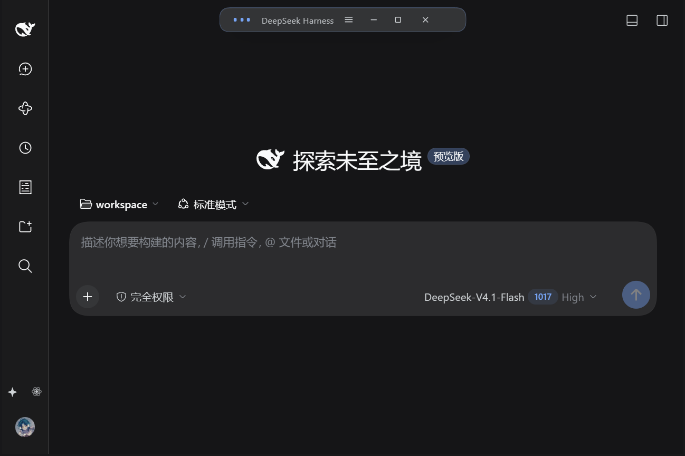

# dsh-frameless-page

A frameless window for **DSH-Portable**. The page-drawn title bar's **middle 50%** is a grab region: hold it to drag the window; hovering it triggers the gravity effect (glowing grab pill, gravity orb following the cursor, particle field collapsing toward it).

The plugin picks one of two modes automatically:

1. **Native frameless (recommended, needs the patched shell)** — the shell hides its native title strip, the web surface fills the whole window, the plugin draws a 44px title bar (identity at left, 50% grab region in the middle, minimize/maximize/close at right) and dragging the grab region moves the **real OS window** (`ReleaseCapture + WM_NCLBUTTONDOWN/HTCAPTION`). Window state (maximized/fullscreen) is synced through `window-state` messages.
2. **Overlay fallback (stock 0.9.4 shell)** — without the `windowChrome` capability the native path is disabled and the old in-window draggable overlay page is used instead, so a window without a title bar can never appear.



- Entry: orbit icon at the bottom of the left sidebar, or `Ctrl+Alt+G`. Auto-opens once on first install (overlay mode).
- The grab region is exactly 50% of the title bar's content width (side zones are 25% each); native mode measured 413.12 / 826.24 = 0.5000.
- All colors/typography come from DSH theme tokens and follow light/dark themes.

## Install

Requires the shell patch from `workspace/native-shell/README-native-frameless.md` for native mode; without it the plugin falls back to the overlay mode.

```powershell
E:\DSH-Portable\dsh.exe plugin --profile web add file:E:\path\to\dsh-frameless-page-0.1.4.tgz
# then restart DSH-Portable
```

The stock 0.9.4 `plugin add` import preflight used to fail on `dsh-better-sidebar`'s `!!js` YAML tag and roll back every install; that bug is fixed now (see `workspace/portable-preflight-fix/NOTES.md`).

## Develop / verify

```powershell
node scripts/build-client.mjs
node scripts/smoke.mjs
node scripts/e2e.mjs "http://127.0.0.1:3097/?token=..." --shots shots/integration
```

Recent verification on a DSH-Portable test host: 21/21 assertions passed (see `shots/integration/e2e-results.json`). Native mode was additionally verified in an isolated portable environment: `[desktop-window] frameless=True`, grab region 50.0000%, hover gravity active, real OS drag moved the window by exactly 180x120 px (`shots/native/`).

See [README.md](README.md) for the full Chinese documentation, file map and boundaries.
